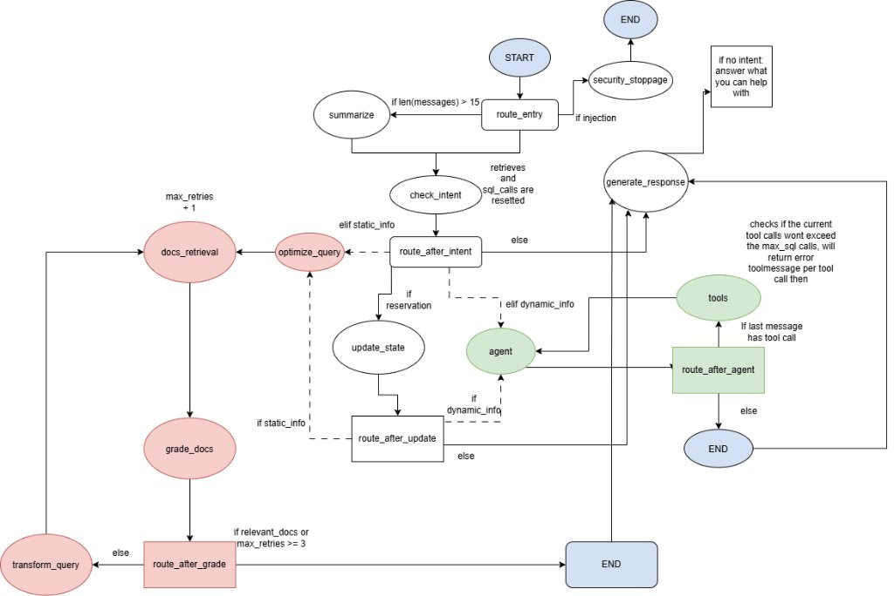

# Parking Space Reservation Chatbot — Stage 1

An intelligent parking-space assistant built with **Python**, **LangChain**, and **LangGraph** as part of the *AI Solution Engineering: Fast Track Course (Module 9)*.

Stage 1 delivers the core **Retrieval-Augmented Generation (RAG)** chatbot with a static/dynamic data split, interactive reservation intake, multi-layer guardrails (including local NLP PII redaction), automated evaluation, and CI tests.

---

## Key Features (Stage 1)

- **Hybrid Static + Dynamic Architecture**
  - **Static data (ChromaDB + BM25):** General parking information, locations, vehicle size rules, accessibility, EV charging, booking/cancellation policies, and privacy terms stored as PDFs and queried via an `EnsembleRetriever` (`0.60` dense OpenAI embeddings + `0.40` sparse BM25) with document grading and query-rewrite retries.
  - **Dynamic data (SQLite):** Date-specific parking availability, opening hours, and hourly prices (`data/parking.db`, `parking_slots` table covering 1–30 November 2026 across 4 Łódź venues) queried by a bounded read-only ReAct SQL agent.
- **Interactive Reservation Collection**
  - Extracts and validates reservation fields across turns: **name**, **car registration number**, **parking venue/address**, and **reservation period** (arrival & departure date/time within November 2026).
  - Automatically checks slot availability in SQL once all fields are valid and suggests available alternatives if the requested venue/time has no free slots.
- **Guardrails & PII Protection**
  - **Prompt injection defense:** Regex + delimiter sanitization (`InputSanitizer`) paired with an LLM security classifier (`SecutiryGuard`) at graph entry.
  - **SQL safety:** Read-only SQLite URI (`?mode=ro`), SQLite authorizer restricted strictly to `SELECT` on `parking_slots`, `safe_sql` single-statement validation, 2-second execution timeout, 50-row cap, and a `MAX_SQL_CALLS = 3` tool-call budget.
  - **Local NLP PII redaction:** Microsoft Presidio (`presidio-analyzer` + `presidio-anonymizer`) backed by spaCy's local `en_core_web_sm` model redacts sensitive entities (`PERSON`, `EMAIL_ADDRESS`, `PHONE_NUMBER`, `CREDIT_CARD`, `IBAN_CODE`, `US_SSN`, `IP_ADDRESS`) on both **vector DB retrieved documents** and **SQL tool rows** before they reach downstream LLMs.
- **RAG Evaluation & Reporting**
  - Reusable evaluation harness measuring `Recall@K`, `Precision@K`, `MRR@K`, and retrieval latency (`avg`, `p50`, `p95`, `max`) with an auto-generated Markdown report.
- **Automated Tests & CI**
  - 33 `pytest` unit tests across guardrails, PII redaction, and evaluation metrics, executed automatically on every push and pull request via GitHub Actions.

---

## Architecture



The main workflow ([graph/graph.py](graph/graph.py)) orchestrates:

1. **Entry & Guardrails (`route_entry` → `security_stoppage` / `summarize_conversation`):** Sanitizes input and checks for prompt injection or policy violations. Summarizes history automatically once conversation length exceeds 15 messages.
2. **Intent Classification (`check_intent`):** Independently classifies each turn into `static_info`, `dynamic_info`, and/or `reservation`, allowing combined requests in a single message.
3. **Reservation Intake (`update_state`):** Merges newly extracted fields with existing `UserState` and validates completeness/date rules (`validate_reservation`).
4. **Static Retrieval Subgraph ([src/retrieval_graph.py](src/retrieval_graph.py)):** Optimizes the query → runs hybrid dense + BM25 search + `redact_pii` → grades retrieved documents → rewrites the query and retries up to `MAX_RETRIES = 3` if no relevant documents pass.
5. **Dynamic SQL Subgraph ([src/react_graph.py](src/react_graph.py)):** ReAct agent calling `execute_readonly_sql` (with `redact_pii_rows` applied to returned rows) within a budget of `MAX_SQL_CALLS = 3`.
6. **Final Response (`generate_response`):** Synthesizes static context, SQL facts, and any missing/invalid reservation fields into a concise reply without falsely confirming unapproved bookings.

---

## Project Structure

```text
parking_project/
├── .github/workflows/
│   └── tests.yml                # GitHub Actions CI (uv sync + pytest)
├── data/
│   ├── chroma_db/               # Persisted Chroma vector database (static PDFs)
│   └── parking.db               # SQLite database (dynamic slots, prices, hours)
├── docs/
│   └── architecture.jpg         # Stage 1 LangGraph workflow diagram
├── eval/
│   ├── dataset.json             # 12 ground-truth RAG evaluation queries
│   ├── evaluate_rag.py          # Recall@K, Precision@K, MRR, latency evaluator
│   └── report.md                # Generated RAG evaluation report
├── graph/
│   └── graph.py                 # Main LangGraph workflow entry point
├── seed_ingest/
│   ├── pdfs/                    # 14 fictional parking policy & location PDFs
│   ├── dynamic_data.py          # Generates data/parking.db (360 November 2026 slots)
│   └── static_data.py           # Ingests PDFs into data/chroma_db
├── src/
│   ├── functions.py             # Retrievers, helpers, Presidio/spaCy PII redaction
│   ├── guardrails.py            # InputSanitizer and safe_sql validation
│   ├── models_vector.py         # OpenAI LLM/embedding & Chroma initialization
│   ├── prompts.py               # System prompts for routing, RAG, SQL, responses
│   ├── react_graph.py           # Read-only SQL ReAct subgraph
│   ├── retrieval_graph.py       # Hybrid RAG + grading/rewrite subgraph
│   ├── schema.py                # Pydantic state & structured-output schemas
│   └── security.py              # LLM-based SecutiryGuard classifier
├── tests/
│   ├── test_eval.py             # Unit tests for RAG evaluation metrics & runner
│   ├── test_guards.py           # Unit tests for injection detection & sanitization
│   └── test_pii.py              # Unit tests for NLP PII redaction & SQL row filtering
├── langgraph.json               # LangGraph Server / Studio configuration
├── pyproject.toml               # Project dependencies (managed by uv)
└── uv.lock                      # Cross-platform lockfile
```

---

## Setup

### Prerequisites
- Python **3.12**
- [uv](https://docs.astral.sh/uv/) package manager
- An OpenAI API key (`OPENAI_API_KEY`)

### 1. Clone & Install Dependencies
```bash
git clone <your-repo-url>
cd parking_project
uv sync --locked
```

> `uv sync --locked` installs all Python dependencies including `presidio-analyzer`, `presidio-anonymizer`, and the local spaCy model `en-core-web-sm`.

### 2. Configure Environment Variables
Create a `.env` file in the project root:
```env
OPENAI_API_KEY=your_openai_api_key
# Optional: LangSmith tracing
# LANGSMITH_TRACING=true
# LANGSMITH_API_KEY=your_langsmith_key
```

### 3. (Optional) Regenerate Data Fixtures
Pre-seeded `data/parking.db` and `data/chroma_db/` are included. To rebuild them from scratch, remove the existing files and run:
```bash
uv run python -m seed_ingest.dynamic_data
uv run python -m seed_ingest.static_data
```

---

## Usage

### Run with LangGraph Studio / Dev Server
Install the LangGraph CLI (if not already installed in your environment) and launch the local dev server configured in [langgraph.json](langgraph.json):
```bash
uv pip install "langgraph-cli[inmem]"
uv run langgraph dev
```

### Invoke Programmatically
```python
from langchain_core.messages import HumanMessage
from graph.graph import graph

result = graph.invoke({
    "messages": [
        HumanMessage(content="Where is Manufaktura parking and is it available on 2026-11-15 from 10:00 to 14:00?")
    ]
})
print(result["messages"][-1].content)
```

---

## RAG Evaluation

Run the evaluation baseline against the production hybrid retriever (`Chroma` + `BM25`) and local Presidio PII redaction:
```bash
uv run python -m eval.evaluate_rag
```

### Latest Results ([eval/report.md](eval/report.md))

Evaluated on 12 queries in [eval/dataset.json](eval/dataset.json):

| Metric | @1 | @4 |
| --- | ---: | ---: |
| **Recall** | 0.875 | 1.000 |
| **Precision** | 1.000 | 0.312 |
| **MRR** | 1.000 | 1.000 |

| Avg Latency | p50 Latency | p95 Latency | Max Latency |
| ---: | ---: | ---: | ---: |
| 426.2 ms | 199.9 ms | 1339.6 ms | 2247.3 ms |

> Note: With 9 single-source queries and 3 two-source queries, the theoretical maximum `Precision@4` is `0.3125` — the retriever achieves `1.000` MRR and `1.000` Recall@4 across all 12 queries.

---

## Testing & CI/CD

Run the full test suite locally:
```bash
uv run python -m pytest tests/ -v
```

| Test Module | Coverage |
| --- | --- |
| [tests/test_guards.py](tests/test_guards.py) | Prompt-injection regex detection and input sanitization |
| [tests/test_pii.py](tests/test_pii.py) | Local Presidio + spaCy PII redaction, public parking allow-list preservation, and SQL row sanitization |
| [tests/test_eval.py](tests/test_eval.py) | `Recall@K`, `Precision@K`, `MRR@K`, percentiles, evaluator runner, and report generation |

GitHub Actions ([.github/workflows/tests.yml](.github/workflows/tests.yml)) automatically installs Python 3.12, syncs locked dependencies via `uv sync --locked` (with caching), and runs `pytest` on every push and pull request.

---

## Roadmap

- **Stage 2:** Human-in-the-Loop administrator approval agent (escalate validated reservation requests and receive approve/reject decisions).
- **Stage 3:** Secure MCP server to persist approved reservations (`Name | Car Number | Reservation Period | Approval Time`).
- **Stage 4:** End-to-end LangGraph orchestration of all agents and MCP recording with integration and load testing.
